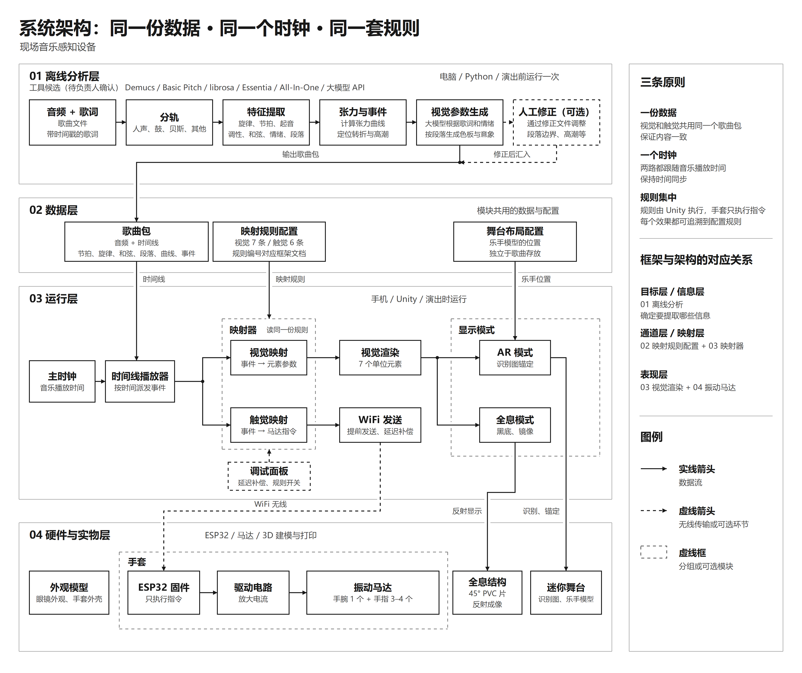

# cross-sensory-live-music

面向听障观众的跨感官现场音乐体验原型：同一份音乐信息按同一套映射规则，同步驱动 AR 视觉与触觉手套。

---

## 当前阶段：架构评审（v0.1）


## 需要做什么？

**黄心健：评审 `docs/framework.md`（设计框架）**

你早上提到，转译策略目前还存在问题，部分内容也有重复。请通读框架，指出**具体哪里**需要修改、**怎么改**。重点关注：

- 映射规则是否合理、能否站得住；
- 不同章节之间是否有重复或互相矛盾的地方；
- 有没有遗漏的信息或规则。

**曾文滔、齐奕雯、黄心健：评审 `docs/architecture.md`（系统架构）**

请从你们各自负责的实现角度出发，考虑这套架构**能不能做出来、哪里可能出问题**。重点关注：

- 各层的关键决定是否合理，有没有更好的做法；
- 实现中可能遇到的技术风险（工具、设备、性能、同步等）；
- 每层"需要讨论"中的问题，以及文档里没有提到、但你认为需要讨论的问题。

## 怎么提意见

在仓库的 **Issues** 里新建一条，标题写成 `[评审] 你的名字 - 文档名`，例如 `[评审] 黄心健 - framework`。每条意见请按下面的格式写，方便逐条讨论和修改：

```
位置：第几节（如 4.2 或 5.3.1）
问题：哪里有问题，为什么
建议：具体怎么改（可以直接写出修改后的文字）
```

只有疑问、暂时没有修改建议的，也可以直接提出。

## 文档导航

| 文件 | 内容 | 谁看 |
|---|---|---|
| [`docs/framework.md`](docs/framework.md) | 设计框架：目标层、信息层、通道层、触觉与视觉的映射规则 | 黄心健重点评审；其他人作为背景参考 |
| [`docs/architecture.md`](docs/architecture.md) | 系统架构：各层任务、关键决定、需要讨论的问题、风险与验证 | 曾文滔、齐奕雯重点评审 |
| [`docs/images/`](docs/images/) | 系统架构图、音乐可视化流程图 | 所有人 |

## 架构概览



整个系统遵循三条原则：**一份数据**（视觉和触觉读同一个歌曲包）、**一个时钟**（都跟随音乐播放时间）、**规则集中**（映射规则写在配置里，由 Unity 统一执行）。

## 后续计划

1. 汇总评审意见，修改框架和架构文档，定稿为 v1.0；
2. 确定分工和数据格式；
3. 在仓库中加入代码目录，进入开发。

