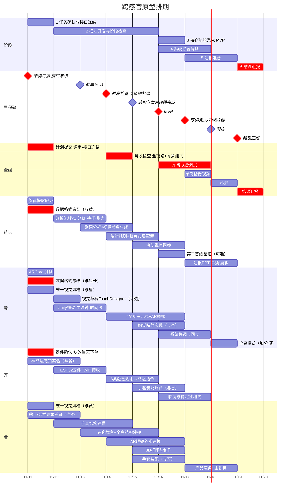

# 项目计划与分工（11.11 – 11.19）

> 11 月 19 日结课汇报。本文包括阶段计划、分工与协作安排、甘特图。

---

## 一、阶段计划

**1. 11 月 11 日｜任务确认与接口冻结**

(a) **目标**：明确各模块的工作边界、最小演示目标、数据接口和统一的视觉风格。

(b) **任务**：中午前各负责人提交开发计划；晚上评审会定稿架构和分工；组长和黄冻结数据格式；同时启动三个验证实验（马达感知与佩戴、ARCore 测试、旋律提取），缺的器件当天下单。

(c) **完成标准**：架构 v1.0 定稿；数据格式写进仓库；器件已到手或已下单。

**2. 11 月 12–15 日｜模块开发与阶段检查**

(a) **目标**：完成 AR 视觉核心效果、音乐数据处理、手套基本反馈和硬件主体建模。

(b) **阶段检查（14 日）**：打通最简全链路，一个节拍和一个乐句同时驱动画面和手套，同步误差不超过 100ms。

(c) **完成标准**：13 日输出歌曲包 v1；14 日全链路打通；15 日手套结构和迷你舞台完成建模。

**3. 11 月 16 日｜核心功能完成（MVP）**

(a) **目标**：所有模块都能单独展示，优先保证视觉和触觉反馈能运行。

(b) **完成标准**：7 个视觉元素能在 AR 中显示；6 条触觉规则能在手套上感知到；手套和舞台实物完成装配。

**4. 11 月 16–17 日｜系统联合调试**

(a) **目标**：用同一段音乐素材，完成音乐数据、AR 视觉和触觉手套之间的联调。

(b) **完成标准**：整首歌能完整跑通一遍；录制一段运行成功的备份视频，防止汇报现场出问题；17 日晚功能冻结，之后只修问题，不再加功能。

**5. 11 月 17–18 日｜汇报准备**

(a) **目标**：完成全部汇报材料。

(b) **任务**：剪辑演示视频；完成产品渲染和主视觉；制作汇报 PPT；全息模式等加分项只在联调已经完成的前提下再做。

(c) **完成标准**：18 日晚全组彩排一次，确认现场演示流程和备用方案。

**6. 11 月 19 日｜结课汇报**

---

## 二、分工与协作安排

模块分工负责，交叉协作推进。

每个人主导各自负责的模块，同时明确跨模块协作内容，保证系统各部分能够顺利衔接。

| 成员  | 负责模块                                       | 主要负责内容                                                                                                                         | 需要协作的地方                                                                                      |
| --- | ------------------------------------------ | ------------------------------------------------------------------------------------------------------------------------------ | -------------------------------------------------------------------------------------------- |
| 组长  | ① 项目统筹 ② 离线分析层 ③ 映射规则配置                    | 1. 任务分配、进度跟进、关键节点管理   2. 分轨、特征提取、张力与事件、歌词分析与视觉参数生成   3. 输出歌曲包；维护映射规则配置，保证和框架文档对应   4. 旋律提取验证（第 1 天）   5. 汇报材料、演示视频 | 与黄：**确定数据格式**；调视觉规则参数；第 3 天后协助做视觉元素  与齐：调触觉规则参数   与全组：协调进度                          |
| 黄   | ① 运行层（Unity）与系统集成 ② AR 视觉实现                | 1. Unity 运行框架：主时钟、时间线播放器、调试面板   2. 视觉映射和 7 个单位元素；AR 模式和全息模式   3. 系统集成、同步控制、延迟补偿   4. ARCore 测试                        | 与组长：数据格式、视觉映射    与齐：触觉指令格式、WiFi 通信、**端到端同步测试**    与曾：识别图位置、舞台与乐手模型尺寸、全息结构、眼镜外观适配 |
| 齐   | ① 触觉手套硬件与固件 ② 触觉映射规则                       | 1. 器件选型：马达、驱动电路、供电   2. ESP32 固件：接收并执行指令（备选：预存振动序列）   3. 接线、装配、调试   4. 裸马达感知实验；触觉效果和稳定性测试   5. 定义 6 条触觉规则对应的马达指令   | 与曾：马达布局、手套结构、走线、佩戴测试，共同装配调试    与黄：指令格式、无线通信、同步；触觉映射在 Unity 里的实现                        |
| 曾   | ① 手套结构与建模 ② AR 眼镜外观 ③ 迷你舞台与全息结构 ④ 产品渲染与主视觉 | 1. 手套建模、马达固定、布线结构；黏土和纸样佩戴验证（第 1–2 天）   2. AR 眼镜外观建模   3. 迷你舞台（识别图位置、乐手模型）、全息 PVC 结构   4. 产品渲染、项目主视觉；辅助手套装配调试          | 与齐：手套结构方案、器件布局、接线装配、佩戴测试   与黄：舞台与 AR/全息的对位、眼镜外观与显示方案                                      |

---

## 三、甘特图

**里程碑**

| 日期 | 里程碑 |
|---|---|
| **11/11 周三** | **架构定稿 · 数据接口冻结 · 器件下单** |
| 11/13 周五 | 歌曲包 v1 |
| **11/14 周六** | **阶段检查：最简全链路打通（同步 ≤100ms）** |
| 11/15 周日 | 手套结构与迷你舞台建模完成 |
| **11/16 周一** | **核心功能完成（MVP）** |
| **11/17 周二** | **联调完成 · 备份视频 · 功能冻结** |
| 11/18 周三 | 汇报材料完成 · 彩排 |
| **11/19 周四** | **结课汇报** |

---

## 四、关键依赖

1. **器件当天下单**：马达、ESP32、驱动板如果手上没有，11 日当天必须下单，否则固件和装配都会被卡住。
2. **数据接口 11 日冻结**：冻结后分析脚本和 Unity 按同一格式开发；分析结果出来前，Unity 先用模拟数据开发。
3. **14 日是关口**：最简全链路必须在这天打通，之后才铺开全部元素，避免拖到最后才第一次联调。
4. **17 日功能冻结**：联调完成、备份视频录好后不再加新功能，只修问题，留出 18 日做汇报材料和彩排。
